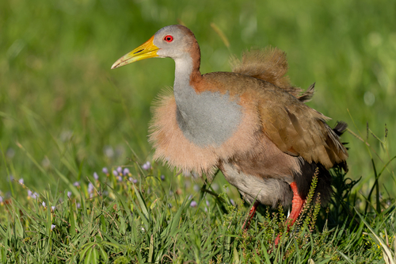

No es el punto central de este posteo, pero disfruto mucho observar aves. Siempre me sorprendió la diversidad de formas, colores y ambientes en los que habitan. Así que aproveché una actividad del curso [Creative Commons Certificate for Educators](https://creativecommons.org/about/cc-certificate-program/) para reunir fotografías de algunas de las aves que conocí en los Esteros del Iberá, en Corrientes, Argentina.

La propuesta también me permitió volver sobre una distinción que inicialmente me costó comprender: ¿cuándo estamos creando una colección y cuándo una adaptación? ¿Qué cambia cuando reunimos fotografías de distintas personas en una misma publicación o cuando las transformamos para producir una obra nueva?

## Una colección de aves del Iberá

Una **colección** reúne obras independientes, sin modificarlas individualmente ni convertirlas en una única obra derivada. Por ejemplo, una galería de fotografías seleccionadas y organizadas alrededor de un tema. Cada fotografía sigue siendo una obra distinta y conserva su licencia original.

Las siguientes imágenes fueron publicadas por diferentes personas con licencias Creative Commons. Las seis fotografías se presentan como obras independientes, sin modificaciones. Sus atribuciones enlazan a las fichas originales en [ArgentiNat](https://www.argentinat.org/home) (la plataforma de la que obtuve las fotos) y a las licencias Creative Commons 4.0 correspondientes.

### Federal (*Amblyramphus holosericeus*)

{fig-alt="Federal de plumaje negro y cabeza roja posado sobre una rama"}

**Atribución:** fotografía de **javiervillamil**. [Foto 618962409](https://www.argentinat.org/observations/340159180). [**CC BY-NC 4.0**](https://creativecommons.org/licenses/by-nc/4.0/), sin modificaciones. Observación registrada en San Martín, Corrientes.

### Chajá (*Chauna torquata*)

{fig-alt="Chajá de cuerpo oscuro, cuello gris y patas rojizas"}

**Atribución:** fotografía de **Josh van der Meulen**. [Foto 254746538](https://www.argentinat.org/observations/147985191). [**CC BY-NC-ND 4.0**](https://creativecommons.org/licenses/by-nc-nd/4.0/), sin modificaciones. Observación registrada en Ituzaingó, Corrientes.

### Cardenal copete rojo (*Paroaria coronata*)

{fig-alt="Cardenal copete rojo de cabeza roja, pecho blanco y dorso gris"}

**Atribución:** fotografía de **Gerónimo Martín Alonso**, publicada por el usuario **Cephisus** en ArgentiNat (autoría indicada en los metadatos del archivo). [Foto 35279227](https://www.argentinat.org/photos/35279227). [**CC BY-NC-ND 4.0**](https://creativecommons.org/licenses/by-nc-nd/4.0/), sin modificaciones. Observación registrada en Colonia Carlos Pellegrini, Esteros del Iberá.

### Lavandera (*Arundinicola leucocephala*)

{fig-alt="Lavandera de cabeza blanca y cuerpo oscuro posada sobre una rama"}

**Atribución:** fotografía de **Laura Veronica Bianchi**. [Foto 751803855](https://www.argentinat.org/photos/751803855). [**CC BY-SA 4.0**](https://creativecommons.org/licenses/by-sa/4.0/), sin modificaciones. Observación registrada en Colonia Carlos Pellegrini, Corrientes.

### Ipacaá (*Aramides ypecaha*)

{fig-alt="Ipacaá de pico amarillo, ojo rojo y cuerpo gris y marrón sobre pasto"}

**Atribución:** fotografía de **Joao Quental**. [Foto 763640846](https://www.argentinat.org/photos/763640846). [**CC BY 4.0**](https://creativecommons.org/licenses/by/4.0/), sin modificaciones. Observación registrada en Colonia Carlos Pellegrini, Corrientes.

### Espátula rosada (*Platalea ajaja*)

{fig-alt="Espátula rosada en vuelo con alas extendidas y pico largo y aplanado"}

**Atribución:** fotografía de **Gonzalo González Mora**. [Foto 459319010](https://www.argentinat.org/photos/459319010). [**CC BY 4.0**](https://creativecommons.org/licenses/by/4.0/), sin modificaciones. Observación registrada en Iberá Birding Lodge, Corrientes.

na colección puede reunir obras publicadas bajo diferentes licencias Creative Commons, siempre que cada una conserve su identidad y se respeten sus condiciones individuales. Esto no convierte a quien organiza la colección en titular de los derechos sobre las obras ajenas. Según las [preguntas frecuentes de Creative Commons sobre colecciones](https://creativecommons.org/faq/#if-i-create-a-collection-that-includes-a-work-offered-under-a-cc-license-which-licenses-may-i-choose-for-the-collection), la licencia que elijo para mis propias contribuciones **no reemplaza** las licencias de los materiales que incorporé.

En mi galería conviven cuatro licencias: **CC BY, CC BY-SA, CC BY-NC y CC BY-NC-ND**. Esto tiene consecuencias concretas:

- **Atribución (BY):** debo reconocer a los autores de todas las fotografías y enlazar sus fuentes y licencias.
- **NoComercial (NC):** las fotografías con esta condición no pueden utilizarse con fines comerciales al amparo de sus licencias. Por eso, la colección completa, tal como está integrada, solo puede compartirse para usos no comerciales, salvo que se obtengan permisos adicionales.
- **CompartirIgual (SA):** la fotografía de la lavandera conserva su licencia CC BY-SA 4.0, pero no obliga a licenciar toda la colección con SA, porque incluirla sin modificar no constituye una adaptación.
- **SinDerivadas (ND):** las fotografías del chajá y el cardenal pueden redistribuirse sin adaptar dentro de una colección no comercial. Sus licencias no autorizan compartir versiones adaptadas sin un permiso adicional o una excepción legal aplicable.

### ¿Qué licencia elegí para mis contribuciones a la colección?

Mis aportes consisten en seleccionar y organizar fotografías de seis aves del Iberá. Además de mi interés por el avistaje de aves, seguí un criterio educativo: incluir deliberadamente obras con diferentes licencias Creative Commons, para comparar sus condiciones de reutilización. Si esta selección u organización alcanza el umbral de originalidad exigido por la ley, puedo licenciar esa contribución, pero no las fotografías de terceros.

Para mis aportes originales a esta colección elijo [**CC BY-NC 4.0**](https://creativecommons.org/licenses/by-nc/4.0/). Es una elección coherente con la presencia de fotografías NC: permite compartir y adaptar mis contribuciones con atribución, para fines no comerciales, sin generar la impresión de que la galería completa puede reutilizarse comercialmente.

¿Qué otras alternativas tenía? Entre las licencias para una colección de uso no comercial, podía considerar **CC BY-NC-SA 4.0**, que exigiría compartir adaptaciones de mis contribuciones bajo condiciones CompartirIgual, o **CC BY-NC-ND 4.0**, que no permitiría compartir sus adaptaciones. Preferí **CC BY-NC** porque no agrega esas dos restricciones a mi selección y organización. La [tabla oficial de Creative Commons para colecciones](https://creativecommons.org/faq/#if-i-create-a-collection-that-includes-a-work-offered-under-a-cc-license-which-licenses-may-i-choose-for-the-collection) distingue las opciones comerciales de las no comerciales.

La condición NC de la galería no significa que las fotografías originalmente licenciadas CC BY o CC BY-SA cambien de licencia: **cada autor conserva los términos que eligió para su fotografía**, incluso cuando ese término permita usos comerciales de la imagen por separado.

### ¿Qué dice la legislación argentina sobre las colecciones?

En Argentina, la [Ley 11.723 de Propiedad Intelectual](https://www.argentina.gob.ar/normativa/nacional/42755/actualizacion) incluye las compilaciones de datos o de otros materiales entre las obras que pueden recibir protección por derechos de autor (artículo 1). Sin embargo, no cualquier agrupación de materiales constituye automáticamente una nueva obra protegida: su selección u organización debe presentar suficiente originalidad. Por eso distingo mis decisiones de curaduría de la autoría de las fotografías que reuní.

## ¿Qué cambia si hago una adaptación?

Una **adaptación** o **obra derivada** surge cuando transformamos una obra preexistente de una manera que, según la legislación aplicable, requiere autorización. Un **remix** combina elementos de dos o más obras en una creación nueva. Por ejemplo, realizar un fotomontaje que integre creativamente elementos de varias fotografías sería un caso mucho más claro de remix que esta galería, donde cada fotografía permanece separada. La [unidad 4.4 del Creative Commons Certificate](https://creativecommons.org/course/cc-cert-edu/unit-4-using-cc-licenses-and-cc-licensed-works/4-4-remixing-cc-licensed-work/) compara una colección con una bandeja de comida que mantiene separados sus componentes, y un remix con un licuado que los mezcla.

No todos los cambios de una obra constituyen adaptaciones. Por ejemplo, convertir un archivo de imagen PNG a JPEG o reducir su resolución para compartirlo en otro formato son, en principio, cambios técnicos permitidos por las licencias, incluso las que incluyen ND. Esto es diferente de transformar creativamente una imagen para producir otra obra.

### Dos tablas que ayudan a evaluar los remixes

Antes de mezclar obras es útil distinguir dos preguntas diferentes:

1. **¿Qué licencia puedo aplicar a mis contribuciones a una adaptación?** El *CC Adapters License Chart* relaciona la licencia original (filas) con las opciones para licenciar el aporte de quien adapta (columnas). Las celdas verdes indican opciones recomendadas; las amarillas, opciones técnicamente posibles pero no recomendadas; y las oscuras, opciones no permitidas.

{fig-alt="Tabla de Creative Commons que compara la licencia de la obra original con la licencia que puede utilizar quien realiza una adaptación" width="100%"}

*Fuente: [«CC Adapter's License Chart», Creative Commons](https://commons.wikimedia.org/wiki/File:CC_Adapter%27s_License_Chart.png), [CC BY 4.0](https://creativecommons.org/licenses/by/4.0/), reproducida sin modificaciones.*

2. **¿Son compatibles las licencias de dos obras que quiero combinar en un remix?** El *CC License Compatibility Chart* cruza dos licencias y marca con un ✓ las combinaciones que permiten compartir el remix y con una ✕ aquellas que no son compatibles bajo las autorizaciones de esas licencias.

{fig-alt="Tabla de compatibilidad de licencias Creative Commons para combinar dos obras en una nueva adaptación" width="100%"}

*Fuente: [«CC License Compatibility Chart», Kennisland](https://commons.wikimedia.org/wiki/File:CC_License_Compatibility_Chart.png), dedicado a [CC0 1.0](https://creativecommons.org/publicdomain/zero/1.0/), reproducido sin modificaciones. Ambas tablas se explican en la [unidad 4.4 del curso](https://creativecommons.org/course/cc-cert-edu/unit-4-using-cc-licenses-and-cc-licensed-works/4-4-remixing-cc-licensed-work/).*

La primera tabla sirve para decidir cómo licenciar mi aporte a una adaptación que sí puedo distribuir. La segunda es anterior en términos prácticos: permite verificar si puedo combinar legalmente las obras seleccionadas para compartir el resultado. Una licencia para mis aportes nunca elimina las obligaciones de las licencias originales.

### ¿Podría hacer y compartir un remix de las seis fotografías?

**No podría compartir un fotomontaje que adapte las seis imágenes basándome exclusivamente en sus licencias actuales.** El problema no se resuelve eligiendo la licencia más restrictiva: las condiciones de algunas fotografías son incompatibles entre sí y otras directamente impiden compartir adaptaciones.

| Licencia de las fotografías | ¿Qué ocurriría si quisiera integrarlas en un remix? |
|---|---|
| **CC BY 4.0** (ipacaá y espátula rosada) | Permite compartir adaptaciones con atribución. Es compatible, por ejemplo, con un remix de obras CC BY-NC o CC BY-SA, respetando las otras condiciones. |
| **CC BY-NC 4.0** (federal) | Permite compartir adaptaciones **no comerciales**. Puede combinarse con las CC BY en un remix que respete NC. |
| **CC BY-SA 4.0** (lavandera) | Permite compartir adaptaciones, pero mi contribución debe licenciarse con **CC BY-SA 4.0** o una licencia oficialmente compatible. Esto es incompatible con integrar la fotografía CC BY-NC en una única adaptación que necesite cumplir ambas condiciones. |
| **CC BY-NC-ND 4.0** (chajá y cardenal) | **No autoriza compartir adaptaciones** de estas fotografías. Necesitaría permisos adicionales de los titulares o que fuera aplicable una excepción legal. |

Hay dos comparaciones que ilustran la diferencia:

- **Remix posible:** combinar creativamente el *federal* (CC BY-NC) con el *ipacaá* (CC BY) y compartir el resultado para fines no comerciales. Para mis aportes originales elegiría CC BY-NC 4.0.
- **Remix que no puedo compartir bajo las licencias actuales:** combinar el *federal* (CC BY-NC) con la *lavandera* (CC BY-SA) en una sola adaptación, porque CC BY-SA exige que mi contribución conserve las condiciones SA y no es compatible con la restricción NC de la otra obra. Tampoco podría compartir un fotomontaje que adapte el *chajá* o el *cardenal* (CC BY-NC-ND) sin permiso adicional.

Por eso, reunir las seis fotografías en una colección sí es posible, mientras que crear y compartir un remix que las integre a todas no lo es bajo las autorizaciones actuales. Esta diferencia muestra por qué resulta indispensable revisar tanto las licencias individuales como las tablas de compatibilidad.

## Licencias y atribuciones de esta publicación

La publicación contiene materiales sujetos a tres declaraciones distintas:

1. **Colección de fotografías («Una colección de aves del Iberá»):** © Jesica Formoso, **selección y organización originales** bajo [CC BY-NC 4.0](https://creativecommons.org/licenses/by-nc/4.0/), en la medida en que estén protegidas por derechos de autor. Esta licencia solo se aplica a mis contribuciones, no a las imágenes preexistentes.
2. **Fotografías de terceros:** cada fotografía conserva la licencia individual indicada junto a la imagen, con atribución y enlace a la obra y a la licencia. Las imágenes NC no pueden utilizarse comercialmente bajo esos términos y las ND no permiten compartir adaptaciones; la licencia de la colección no sustituye esas condiciones.
3. **Material educativo completo (texto y explicaciones originales de este post):** © Jesica Formoso, bajo [CC BY 4.0](https://creativecommons.org/licenses/by/4.0/), **excepto la colección y los materiales de terceros identificados por separado**. Por tanto, compartir o reutilizar el post completo junto con las seis fotos requiere respetar también las restricciones individuales, incluido el uso no comercial.

Esta distinción es importante: el texto original de mi artículo puede reutilizarse comercialmente bajo CC BY, pero **no implica** que las seis fotografías que lo acompañan puedan utilizarse comercialmente.

### Materiales consultados

Las explicaciones se elaboraron en español, con redacción propia, a partir de estos recursos del *Creative Commons Certificate for Educators*, publicados por Creative Commons bajo [CC BY 4.0](https://creativecommons.org/licenses/by/4.0/):

- Creative Commons. [4.1 Choosing and Applying a CC License](https://creativecommons.org/course/cc-cert-edu/unit-4-using-cc-licenses-and-cc-licensed-works/4-1-choosing-and-applying-a-cc-license/).
- Creative Commons. [4.3 Finding and Reusing CC-Licensed Work](https://creativecommons.org/course/cc-cert-edu/unit-4-using-cc-licenses-and-cc-licensed-works/4-3-finding-and-reusing-cc-licensed-work/).
- Creative Commons. [4.4 Remixing CC-Licensed Work](https://creativecommons.org/course/cc-cert-edu/unit-4-using-cc-licenses-and-cc-licensed-works/4-4-remixing-cc-licensed-work/).
- Creative Commons. [Preguntas frecuentes: licenciamiento de colecciones](https://creativecommons.org/faq/#if-i-create-a-collection-that-includes-a-work-offered-under-a-cc-license-which-licenses-may-i-choose-for-the-collection).
- Creative Commons. [Preguntas frecuentes: compatibilidad para remixes](https://creativecommons.org/faq/#can-i-combine-material-under-different-creative-commons-licenses-in-my-work).