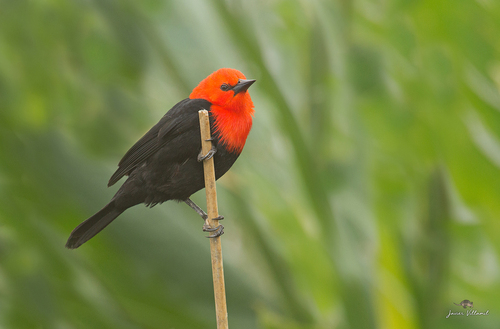
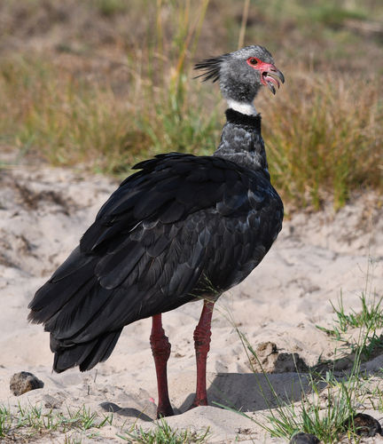
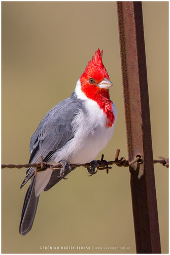
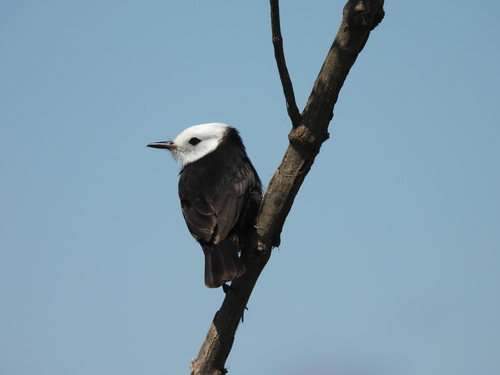
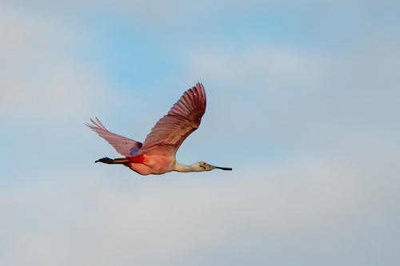

No es el punto central de este posteo, pero disfruto mucho observar aves. Siempre me sorprendió la diversidad de formas, colores y ambientes en los que habitan. Así que aproveché una actividad del curso [Creative Commons Certificate for Educators](https://creativecommons.org/about/cc-certificate-program/) para reunir fotografías de algunas de las aves que conocí en los Esteros del Iberá, en Corrientes, Argentina.

La propuesta también me permitió volver sobre una distinción que inicialmente me costó comprender: ¿cuándo estamos creando una colección y cuándo una adaptación? ¿Qué cambia cuando reunimos fotografías de distintas personas en una misma publicación o cuando las transformamos para producir una obra nueva?

## Una colección de aves del Iberá

Una **colección** reúne obras independientes, sin modificarlas individualmente ni convertirlas en una única obra derivada. Por ejemplo, una galería de fotografías seleccionadas y organizadas alrededor de un tema. Cada fotografía sigue siendo una obra distinta y conserva su licencia original.

Las siguientes imágenes fueron publicadas por diferentes personas con licencias Creative Commons. Las seis fotografías se presentan como obras independientes, sin modificaciones. Sus atribuciones enlazan a las fichas originales en [ArgentiNat](https://www.argentinat.org/home) (la plataforma de la que obtuve las fotos) y a las licencias Creative Commons 4.0 correspondientes.

### Federal (*Amblyramphus holosericeus*)

{fig-alt="Federal de plumaje negro y cabeza roja posado sobre una rama"}

**Atribución:** fotografía de **javiervillamil**. [Foto 618962409](https://www.argentinat.org/observations/340159180). [**CC BY-NC 4.0**](https://creativecommons.org/licenses/by-nc/4.0/), sin modificaciones. Observación registrada en San Martín, Corrientes.

### Chajá (*Chauna torquata*)

{fig-alt="Chajá de cuerpo oscuro, cuello gris y patas rojizas"}

**Atribución:** fotografía de **Josh van der Meulen**. [Foto 254746538](https://www.argentinat.org/observations/147985191). [**CC BY-NC-ND 4.0**](https://creativecommons.org/licenses/by-nc-nd/4.0/), sin modificaciones. Observación registrada en Ituzaingó, Corrientes.

### Cardenal copete rojo (*Paroaria coronata*)

{fig-alt="Cardenal copete rojo de cabeza roja, pecho blanco y dorso gris"}

**Atribución:** fotografía de **Gerónimo Martín Alonso**, publicada por el usuario **Cephisus** en ArgentiNat (autoría indicada en los metadatos del archivo). [Foto 35279227](https://www.argentinat.org/photos/35279227). [**CC BY-NC-ND 4.0**](https://creativecommons.org/licenses/by-nc-nd/4.0/), sin modificaciones. Observación registrada en Colonia Carlos Pellegrini, Esteros del Iberá.

### Lavandera (*Arundinicola leucocephala*)

{fig-alt="Lavandera de cabeza blanca y cuerpo oscuro posada sobre una rama"}

**Atribución:** fotografía de **Laura Veronica Bianchi**. [Foto 751803855](https://www.argentinat.org/photos/751803855). [**CC BY-SA 4.0**](https://creativecommons.org/licenses/by-sa/4.0/), sin modificaciones. Observación registrada en Colonia Carlos Pellegrini, Corrientes.

### Ipacaá (*Aramides ypecaha*)

{fig-alt="Ipacaá de pico amarillo, ojo rojo y cuerpo gris y marrón sobre pasto"}

**Atribución:** fotografía de **Joao Quental**. [Foto 763640846](https://www.argentinat.org/photos/763640846). [**CC BY 4.0**](https://creativecommons.org/licenses/by/4.0/), sin modificaciones. Observación registrada en Colonia Carlos Pellegrini, Corrientes.

### Espátula rosada (*Platalea ajaja*)

{fig-alt="Espátula rosada en vuelo con alas extendidas y pico largo y aplanado"}

**Atribución:** fotografía de **Gonzalo González Mora**. [Foto 459319010](https://www.argentinat.org/photos/459319010). [**CC BY 4.0**](https://creativecommons.org/licenses/by/4.0/), sin modificaciones. Observación registrada en Iberá Birding Lodge, Corrientes.

## ¿Qué licencia tiene una colección?

La colección reúne fotografías con licencias **CC BY, CC BY-SA, CC BY-NC y CC BY-NC-ND**. Esto es posible porque cada imagen permanece independiente. Las condiciones de las licencias originales siguen vigentes: atribución en todos los casos, uso no comercial para las fotografías NC, y prohibición de compartir adaptaciones de las fotografías ND sin permiso adicional o una excepción legal aplicable.

La selección y organización de obras puede tener protección propia si cumple los requisitos de originalidad de la legislación aplicable. En ese caso, puedo licenciar mis contribuciones originales a la colección pero no puedo cambiar las licencias de las fotografías de terceros.

Para mis aportes originales a la colección elijo una licencia [CC BY 4.0](https://creativecommons.org/licenses/by/4.0/), que permite la reutilización y adaptación con atribución. Otras opciones habrían sido CC BY-SA (CompartirIgual), CC BY-NC (NoComercial) o CC0 (dedicación al dominio público en la medida permitida). Lo importante es que ninguna de ellas cambiaría los derechos de las personas que tomaron las fotografías.

## ¿Qué cambia si hago una adaptación?

Una **adaptación** surge cuando transformamos una obra preexistente de una manera que requiera autorización según la ley de derechos de autor aplicable. Un ejemplo sería combinar elementos de varias fotografías en un fotomontaje o collage nuevo.  

Por lo tanto, si en lugar de esta galería quisiera compartir un fotomontaje que incorporara las seis fotografías, mis opciones cambiarían:

- **CC BY:** permite compartir adaptaciones con atribución y las demás condiciones correspondientes.
- **CC BY-SA:** las adaptaciones compartidas deben cumplir CompartirIgual, usando la misma licencia o una compatible.
- **CC BY-NC:** el uso debe ser no comercial, también cuando se trata de adaptaciones.
- **CC BY-NC-ND:** la licencia no autoriza compartir adaptaciones. Necesitaría permiso adicional de la persona titular de los derechos de autor de esta obra.

Por eso, que varias obras puedan agruparse en una colección no significa que podamos combinarlas libremente en una adaptación. En ese caso, tenemos que analizar las condiciones de cada licencia individual y determinar si son compatibles con la adaptación que queremos compartir.

Ahora, no todo cambio técnico constituye una adaptación. Por ejemplo, si el archivo original se encuentra en formato .png y lo cambio a .jpeg, esta modificación no constituye una adaptación. Tampoco son adaptaciones el generar una versión de menor resolución o cambiar el sorporte (por ejemplo, imprimir una fotografía digital en papel), siempre y cuando no alteremos la imagen.

### ¿Qué dice la legislación argentina sobre las colecciones?

En Argentina, la [Ley 11.723 de Propiedad Intelectual](https://www.argentina.gob.ar/normativa/nacional/42755/actualizacion) incluye expresamente las compilaciones de datos o de otros materiales entre las obras que pueden recibir protección por derechos de autor (artículo 1).

Sin embargo, no cualquier conjunto de materiales constituye automáticamente una obra protegida, sino que se considera que la selección u organización debe presentar suficiente originalidad.

En esta colección, seleccioné fotografías de seis especies de aves de los Esteros del Iberá. La elección responde a mi interés personal por el avistaje de aves pero también a los fines educativos de reunir fotografías con diferentes licencias Creative Commons para mostrar cómo pueden convivir dentro de una misma colección.

La selección incluye fotografías de diferentes autores, publicadas bajo licencias CC BY, CC BY-SA, CC BY-NC y CC BY-NC-ND.

Aunque no sé con certeza si la selección y organización de esta colección alcanzan el grado de originalidad necesario para recibir protección por derechos de autor en Argentina, elijo compartir mis aportes originales bajo CC BY 4.0, en la medida en que estén protegidos. Esto facilita su reutilización.

## Licencias y atribuciones de esta publicación

**Texto y contribuciones originales:** © Jesica Formoso. Se comparten bajo [Creative Commons Atribución 4.0 Internacional (CC BY 4.0)](https://creativecommons.org/licenses/by/4.0/), en la medida en que estén protegidos por derechos de autor.

**Fotografías:** conservan las licencias individuales indicadas debajo de cada imagen. La licencia CC BY 4.0 de mis contribuciones no se extiende a ellas. La reutilización de la publicación completa debe respetar también las restricciones NC y ND aplicables a las fotografías correspondientes.

**Materiales consultados:** para este posteo consulté los siguientes materiales del *Creative Commons Certificate for Educators*, publicados por Creative Commons bajo una licencia [CC BY 4.0](https://creativecommons.org/licenses/by/4.0/):

- Creative Commons. [4.1 Choosing and Applying a CC License](https://creativecommons.org/course/cc-cert-edu/unit-4-using-cc-licenses-and-cc-licensed-works/4-1-choosing-and-applying-a-cc-license/).
- Creative Commons. [4.3 Finding and Reusing CC-Licensed Work](https://creativecommons.org/course/cc-cert-edu/unit-4-using-cc-licenses-and-cc-licensed-works/4-3-finding-and-reusing-cc-licensed-work/).
- Creative Commons. [4.4 Remixing CC-Licensed Work](https://creativecommons.org/course/cc-cert-edu/unit-4-using-cc-licenses-and-cc-licensed-works/4-4-remixing-cc-licensed-work/).

